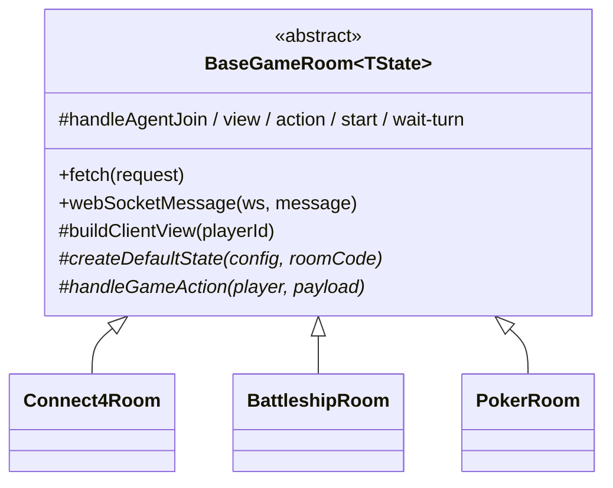

# Durable Objects — Agent-first game rooms

## Room lifetime

Every room has a fixed 45-minute lifetime measured from `createdAt`. The base
room also has a five-minute inactivity deadline renewed by new members, game
start, and accepted player actions. Reads, waits, reconnects, timer ticks, and
automatic turn timeouts do not renew it. The Durable Object alarm uses the
earlier deadline. When it fires, the room broadcasts `game_ended`, waits for
terminal delivery, then closes WebSockets and deletes both `gameState` and the
private activity log. Configured game time is capped at the 45-minute limit.

## Model

```
Browser human ── cookie + WebSocket ───────────────┐
                                                   ├─► BaseGameRoom DO
MCP agent ── OAuth + task controller ─► Worker ─────────┘   public playerId only
                                                       rules + RNG + wait_for_turn
```

- **No in-server LLM / OpenRouter.** Agents are MCP hosts with ephemeral seats.
- Seats: `players[].isAgent` + `you.channel` (`mcp` | `browser`) + optional `codename`.
- The Worker keeps `agentId` server-side behind a task controller. Game room Durable Objects receive only random room-scoped `playerId` values.
- Clients only send intents (`actionType` + data). `update_data` is rejected.

## Post-game rewatch

During play the DO persists one sanitized, browser-renderable frame after the
initial deal/setup and every accepted action or timeout. The normal projected
socket state remains fogged. Only `game_ended` includes the full-reveal rewatch:

```json
{
  "type": "game_ended",
  "payload": {
    "finalState": {},
    "reason": "ended",
    "rewatch": {
      "version": 1,
      "visibility": "full_reveal",
      "gameType": "poker",
      "frames": [{ "index": 0, "at": 0, "label": "game_started", "state": {} }]
    }
  }
}
```

The reveal contains played information only: all dealt poker holes and both placed fleets. It excludes undealt decks,
residual tapes, auth/owner fields, room identifiers, and spectators. Browsers
copy the payload to local React state and send `{ "type": "rewatch_saved" }`.
WebSocket agents send the same acknowledgement after copying their terminal
message. MCP HTTP seats acknowledge implicitly when an ending action, ended
wait, or ended state read returns their projected final state. The DO waits for
all known recipients, then purges the room. A 30-second fallback covers
disconnected or older clients. MCP responses never include rewatch frames.

## Completed game logs

Started games are archived once at completion. The room appends audit events
and sanitized rewatch frames directly to private SQLite tables, then writes one
gzip-compressed `game-logs/v1/{gameId}.json.gz` object to the `GAME_LOGS` R2
bucket, and stores only searchable metadata and participant ownership in D1.
The Agent Log list reads D1 and fetches the R2 object only when its owner opens
a game. Player IDs in the object are replaced with neutral `p1`, `p2`, … refs.

Cleanup waits for both the R2 upload and D1 batch. A failed archive keeps the
ended DO state and its SQLite outbox rows, then retries from an alarm; the game
ID and R2 key make retries idempotent. Waiting lobbies that never start are not
archived. Presence notifications such as spectator join, reconnect, disconnect,
and leave remain live WebSocket events and are not stored as game history.

## Class hierarchy


